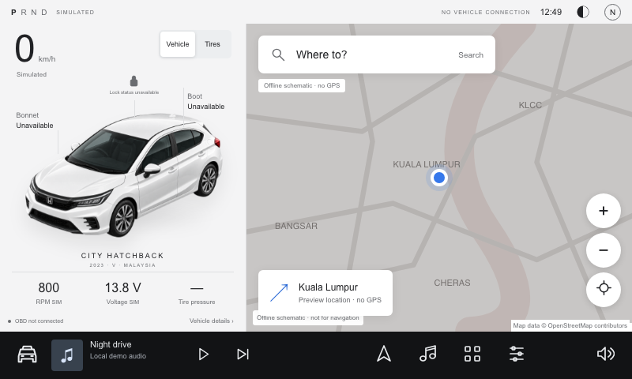
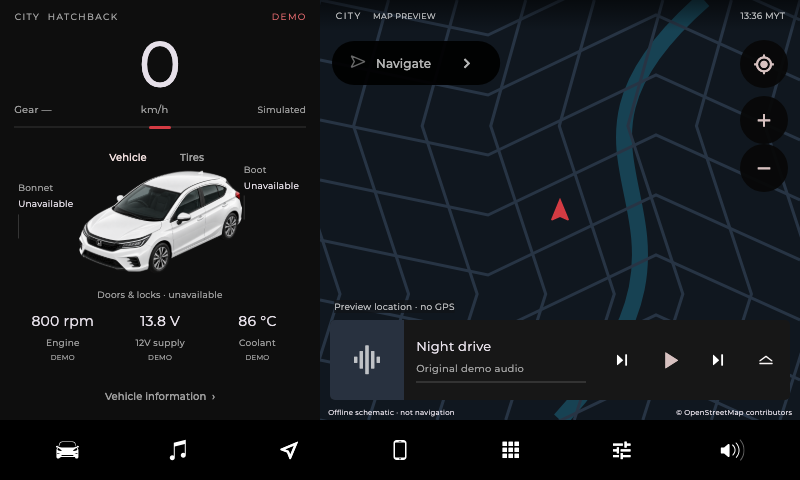
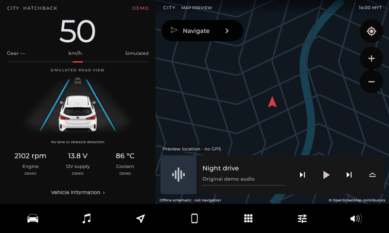

# Open Dash

A Tesla-inspired infotainment dashboard for Android, built with Flutter.

The goal is one dashboard with vehicle profiles for different cars. The current prototype uses a 2023 Honda City Hatchback V as its first example. Support for other cars is planned.

## Before

The earlier working prototype:



## Proposed layout

The current working app implements this direction: vehicle information on the left, a map on the right, and a persistent bottom dock.

### Parked



### Demo drive



These are screenshots of the runnable app. The road and car ahead are simulated, not camera detections. The screenshots use the offline map preview.

## What works today

- Layouts for 800 × 480 and 1024 × 600 landscape screens.
- Dark and light themes, animated panels, and a rear-view demo driving scene.
- Interactive map, optional one-time location, and destination handoff to a maps app.
- Local demo music, app shortcuts, and vehicle information panels.
- Clearly labeled demo telemetry. Unsupported readings stay unavailable.

Live OBD, dashcam integration, lane detection, and vehicle controls are not implemented. Factory camera and LaneWatch systems are not connected to the app. Actual AI box compatibility still needs hardware testing.

## Try it without a car

Download the APK or browser preview from [Releases](https://github.com/naimroslan/open-dash/releases).

To run from source, install [Flutter](https://docs.flutter.dev/install), then run these commands from the project folder:

```sh
flutter pub get
flutter run -d chrome
```

Open **Settings**, enable **Demo telemetry**, then enable **Animate demo drive**. No OBD adapter or AI box is needed.

The Android APK requires ARM64 and Android 8.0 or newer. The current release uses a development signing key.

See [build instructions](BUILDING.md) for Android installation, emulator testing, and the prebuilt browser preview.

## Planned

- Selectable vehicle profiles with car artwork, labels, and supported readings.
- More car models beyond the initial Honda prototype.
- Read-only OBD integration with support checked for each vehicle and adapter.
- Testing on Android AI boxes and head units.

These are plans, not current compatibility claims. Contributions with vehicle details and verified hardware results are welcome.

## More details

[Design](DESIGN.md) · [Hardware testing](HARDWARE.md) · [Limitations](LIMITATIONS.md) · [Verification](VERIFICATION.md) · [Credits](THIRD_PARTY.md)

Independent project, not affiliated with Tesla or Honda. Design and asset attribution is in [THIRD_PARTY.md](THIRD_PARTY.md).
